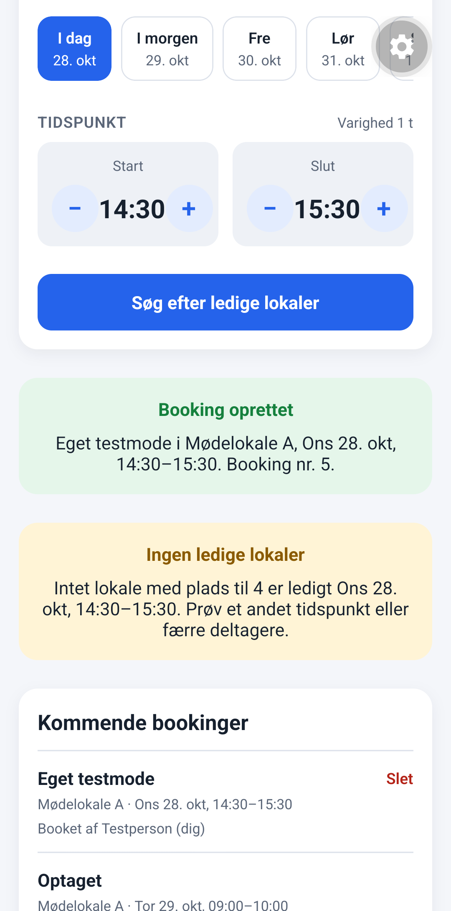
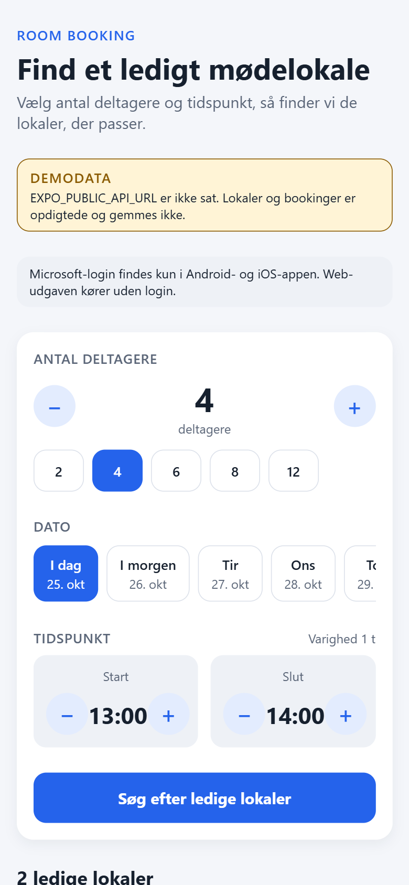
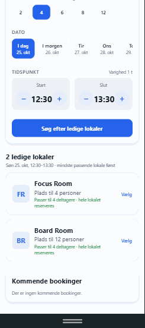
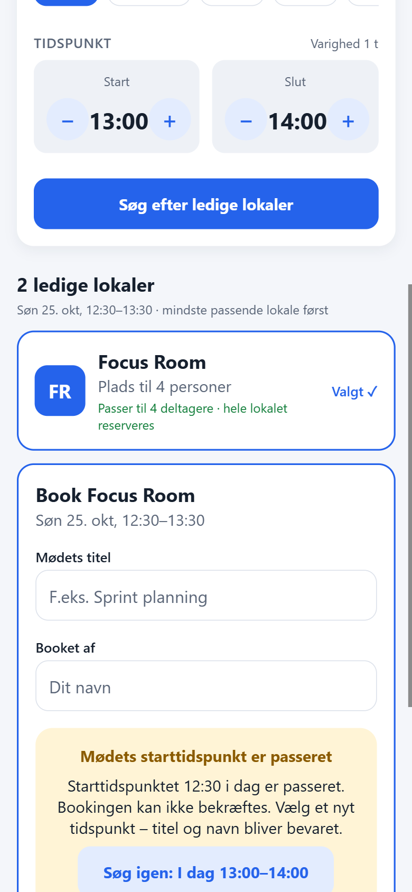
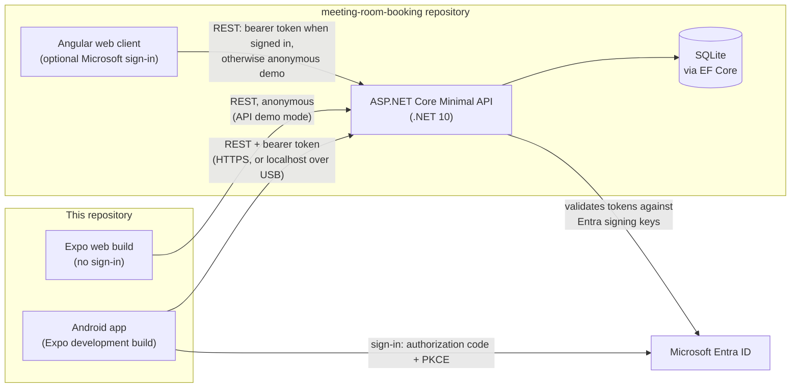

# Room Booking Mobile

[](https://github.com/kris7011/room-booking-mobile/actions/workflows/ci.yml)
[](https://github.com/kris7011/room-booking-mobile/actions/workflows/e2e.yml)

A React Native (Expo) client for the
[meeting-room-booking](https://github.com/kris7011/meeting-room-booking)
ASP.NET Core API. Find a free meeting room for a number of people, a day and
a time, and book it from an Android phone or a browser. Optional Microsoft
Entra ID sign-in gives access to organisations and their rooms.

## Screenshots

**Android development build** on a Samsung SM-A057G, signed in as a Member
of a test organisation on an isolated database copy (synthetic data; status
bar cropped). The user's own booking shows its title, *Slet* and "Booket af …
(dig)"; another person's booking only says *Optaget* with room and time,
because the API leaves out its details for Members.

<a href="docs/images/android-member-bookings.png"></a>

**Expo Web demo mode**: actual Room Booking UI captured in Chrome's mobile viewport
(390 × 844 CSS pixels, exported as 780 × 1688 PNGs). These are
**Expo Web demo-mode** captures, not screenshots of the native
Android build. Data is fictional and no Microsoft account is signed in.
Click a screenshot to see the full-size image.

| Search for a room | Available rooms | Booking form & validation |
| :---: | :---: | :---: |
| <a href="docs/images/search.png"></a> | <a href="docs/images/results.png"></a> | <a href="docs/images/booking-form.png"></a> |

Capture provenance and safety guidance: [screenshots documentation](docs/images/README.md).

## Purpose

People who share a set of meeting rooms need to find one that fits the group
and is free at the right time, without double bookings, and without seeing
another organisation's rooms. The API enforces those rules; this app is the
mobile client for it.

The project is also a deliberate exercise in the parts of a mobile app that
are easy to get wrong: native sign-in and token storage, sending tokens only
over safe transports, keeping one organisation's data out of another's
screens, local time versus UTC, and testing against a real backend rather
than mocks alone.

## Key features

- Search for free rooms by number of participants, day (next 14 days) and
  time in 30-minute steps; the smallest fitting room is listed first.
- Booking form with validation that matches the API's rules, and readable
  (Danish) messages for overlapping bookings (409) and validation errors (400).
- A suggested search time that keeps up with the clock, and a booking whose
  start has passed cannot be confirmed ([time handling](docs/time-handling.md)).
- Optional Microsoft Entra ID sign-in on Android and iOS for personal
  Microsoft accounts (Outlook.com, Hotmail) and work or school accounts:
  OAuth 2.0 authorization code flow with PKCE as a public client (no
  secret), refresh token in SecureStore, silent renewal
  ([details](docs/entra-login.md)). Room Booking stores no passwords.
- Optional e-mail sign-in with a one-time code through Microsoft Entra
  External ID, next to Microsoft sign-in ([details](docs/external-id-login.md)):
  implemented and unit-tested, **not yet run against Microsoft** (the
  external tenant does not exist yet).
- Linking a second login (another Microsoft account, or the e-mail code) to
  the same user, only after signing in with it and confirming; never by
  e-mail ([details](docs/identity-linking.md)). Unit-tested; not yet run
  with real sign-ins.
- Organisations for signed-in users: choose the active organisation, create
  one, accept invitations; Owners and Admins manage rooms, members and
  invitations ([details](docs/organisations.md)).
- Private booking details: a Member sees when a room is taken, but not the
  title or organiser of other people's bookings (*Optaget*); the API removes
  them before they reach the phone.
- A clearly labelled demo mode with in-memory data, so the app runs without
  a backend.

The user interface is in Danish; code and documentation are in English.

## Implementation and testing status

| Area | Implemented | Automated tests | Checked by hand |
|---|---|---|---|
| Search and booking without sign-in | Yes | Unit tests; E2E in the web build against the real API | Web: yes. Android: no result recorded |
| Signed-in search and booking | Yes | Unit tests (API client against a mocked `fetch`) | Samsung, 26 Oct 2026: booking in an organisation, kept after restart (owner report); 27 Oct 2026: bookings on an isolated copy, incl. a retry after a lost connection, each saved once (logged) |
| Time handling | Yes | Unit tests; E2E with a controlled browser clock | Android checklist not run yet |
| Private booking details for Members | Yes (API enforces it) | Unit tests; API integration tests in the backend | Samsung, 28 Oct 2026: *Optaget* for another person's booking, own booking in full, on an isolated copy (logged, [record](docs/device-testing.md#booking-privacy-pr-37-28-october-2026)) |
| Microsoft Entra sign-in | Android/iOS only | Unit tests with fakes for the browser, Entra and SecureStore | Samsung development build, 26 Oct 2026: `/common/` authority and redirect handler configured, personal-account session restored after a restart (logged); sign-out and a new interactive sign-in (owner report). 28 Oct 2026, on the rebuilt build: sign-out and a new sign-in, SecureStore holds only ciphertext and no auth entry after sign-out, no tokens in the recorded logs (logged; account picker by owner report). Work or school account not tried |
| Organisations and administration | Yes, for signed-in users | Unit tests; role rules enforced and tested in the API | Samsung, 26 Oct 2026: Owner screens and actions (writes on an isolated database copy). Admin and Member views not tried (one account only). 27 Oct 2026: sole-Owner member list (PR #22), booking retry after a lost connection (PR #26) and organisation access refresh (PR #27) on an isolated copy (logged) |
| Switching between a local and a hosted API | Development builds only ([details](docs/api-targets.md)) | Script smoke test in CI | Windows PowerShell 5.1 on an isolated copy |
| Android development build | Yes | `app.json` and generated manifest checked in tests | Built and installed on a Samsung SM-A057G; deep link verified; rebuilt after the Expo patch update of 26 Oct 2026, and again from `main` with the SDK 58 patches of PR #29 on 28 Oct 2026 (installed as an update, app data kept). The Phase 5F fixes (PRs #30–#32) passed on that build ([F1–F4](docs/device-testing.md#phase-5f-f1f4), logged) |
| iOS | Shared code only | – | Never built |
| Release builds and store distribution | No | – | – |

The full record of what was verified on the phone, and the open checklists,
is in [docs/device-testing.md](docs/device-testing.md).

## Architecture



- The **API is the authority**: it validates the access token, identifies the
  user by issuer and object ID, and enforces organisation membership and
  roles. The app never decides who the user is or what they may do.
- **Signed in**, the app calls `/api/organizations/{id}/…` for the active
  organisation. **Signed out** (and always on web), it calls the original
  `/api/rooms` and `/api/bookings`, which the API only serves anonymously in
  its Development-only demo mode. This app's web build has no sign-in (a
  deliberate decision); the Angular client in the backend repository has its
  own Microsoft sign-in.
- What each client can do (this app on Android and on the web, the Angular
  client, the API) is compared in the backend's
  [capability matrix](https://github.com/kris7011/meeting-room-booking#what-each-client-does).

The code structure, sign-in flow and request handling are explained in the
[developer walkthrough](docs/PROJECT_WALKTHROUGH.md).

### What the backend guarantees

Correctness rules are enforced by the API and its database, not by this app.
Summarised from the
[backend walkthrough](https://github.com/kris7011/meeting-room-booking/blob/main/docs/PROJECT_WALKTHROUGH.md),
which links each point to its code and tests:

- **Tenant isolation.** Every organisation endpoint sits under
  `/api/organizations/{organizationId}` behind one route-group filter that
  checks the token, the registered user and membership of that organisation.
  Non-members get `404`, so they cannot tell whether it exists. Roles are read
  from the database on every request, never from the token, and queries are
  also filtered by organisation, so a guessed ID from another organisation is
  "not found".
- **No double bookings, also under concurrency.** The overlap check and the
  insert run in one transaction that takes SQLite's write lock at its start
  (`BEGIN IMMEDIATE`), so two parallel requests cannot both pass the check.
  Database triggers re-check overlaps on every insert and update, and a
  composite foreign key keeps a booking in its room's organisation.
  Integration tests use parallel requests and direct SQL to try to bypass it.
- **Safe retries.** Registration is idempotent per identity (issuer + object
  ID), and creating an organisation honours the `Idempotency-Key` this app
  sends, so a retry after a timeout never creates a duplicate.

## Tech stack

- Expo SDK 58, React Native 0.88, React 19.3, TypeScript 6 (strict)
- expo-auth-session, expo-web-browser, expo-crypto, expo-secure-store for
  sign-in; expo-dev-client for the Android development build
- react-native-web for the browser build
- Node's built-in test runner (`node:test`) for unit and integration tests
- Playwright for end-to-end tests
- GitHub Actions for CI
- Backend ([separate repository](https://github.com/kris7011/meeting-room-booking)):
  ASP.NET Core Minimal API on .NET 10, EF Core 10 with SQLite, Microsoft Entra
  ID token validation, and an Angular web client

## Engineering decisions

1. **Native sign-in as a public client with PKCE.** A mobile app cannot keep
   a secret, so it has none; PKCE binds the authorization code to the app
   instance that requested it. Only the refresh token is persisted, in
   SecureStore (Android Keystore / iOS Keychain); the access token stays in
   memory. The cost is that sign-in needs a development build instead of
   Expo Go. [ADR 0001](docs/adr/0001-native-sign-in-and-token-storage.md)
2. **The API decides identity and access; the app only displays.** The ID
   token is used for display only; the app asks `GET /api/me` who the user
   is. Role-based buttons are a convenience, not authorization. Every
   organisation request names the organisation in its URL, the booking area
   is re-created per organisation, and every request is bound to the session
   it started in, so a sign-out or account switch can never send it as
   someone else.
3. **Token transport is enforced in code, not configuration.**
   `canSendBearerToken` sends tokens over HTTPS only in a release bundle, and
   additionally to loopback addresses in a development bundle (for
   `adb reverse` over USB). A wrong `.env.local` therefore cannot leak a token
   over Wi-Fi. The API address is fixed at bundle time, so switching servers
   needs a Metro restart or a new build.
   [ADR 0002](docs/adr/0002-api-target-and-token-transport.md)
4. **Framework-free core logic with injected dependencies.** The sign-in
   state machine, the organisation controller and the HTTP client import
   neither React nor Expo. They run under Node's test runner with fakes,
   which makes race conditions (sign-out during a token refresh, for
   example) testable deterministically and keeps the suite fast on modest
   hardware. The trade-off is more wiring code and no component tests.
5. **End-to-end tests against the real API and a throwaway database.**
   Mocks can drift from the backend's real behaviour. The E2E suite builds
   and starts the actual .NET API on a new SQLite file per run, exports the
   web app, and drives it in Chromium with a frozen clock; CI checks out the
   backend repository to do the same. It is slower and covers the web build
   only, which is why device checklists remain.

## Testing and CI

| Check | Command | Runs in CI |
|---|---|---|
| Type checking (app, tests, E2E) | `npm run typecheck` | `ci.yml` |
| ESLint (`eslint-config-expo`, fails on any warning) | `npm run lint` | `ci.yml` |
| Unit and integration tests | `npm test` | `ci.yml` |
| Dependency versions against Expo SDK 58 | `npx expo-doctor` | `ci.yml` |
| API target script smoke test | – | `ci.yml` (PowerShell 7) |
| End-to-end tests (web build, real API, SQLite) | `npm run test:e2e` | `e2e.yml` |

Both workflows run on every pull request and on pushes to `main`. What each
layer covers, and what is deliberately not automated, is described in
[docs/testing.md](docs/testing.md).

## Quickstart

Prerequisites: Node.js 24 and npm.

```bash
git clone https://github.com/kris7011/room-booking-mobile.git
cd room-booking-mobile
npm ci
npm run web        # demo mode: in-memory data, no backend needed
```

Against the real API (requires the .NET 10 SDK and the
[meeting-room-booking](https://github.com/kris7011/meeting-room-booking)
repository):

```powershell
# In meeting-room-booking: the web build has no sign-in, so enable the API's demo mode
$env:LegacyApi__AllowAnonymous = "true"
dotnet run --project .\src\MeetingRoomBooking.Api\MeetingRoomBooking.Api.csproj --launch-profile http

# In this repository
Copy-Item .env.example .env.local   # sets EXPO_PUBLIC_API_URL=http://localhost:5003
npm run web
```

Microsoft sign-in requires the Android development build and an Entra app
registration: see [android-development-build.md](docs/android-development-build.md)
and [entra-login.md](docs/entra-login.md). More commands and per-device API
addresses are in [local-development.md](docs/local-development.md).

## Documentation

| Document | Contents |
|---|---|
| [Developer walkthrough](docs/PROJECT_WALKTHROUGH.md) | Architecture, sign-in, API calls, organisations, testing strategy, design decisions |
| [Architecture decision records](docs/adr/README.md) | Sign-in and token storage; API selection and token transport; safe booking retries; organisation access synchronisation |
| [Local development](docs/local-development.md) | Demo and live mode, API addresses per device, commands, project structure |
| [Microsoft Entra sign-in](docs/entra-login.md) | How sign-in works, configuration, Entra app registration, troubleshooting |
| [Organisations](docs/organisations.md) | Organisation features and how stale data is avoided |
| [Time handling](docs/time-handling.md) | Suggested versus chosen times, passed start times, time zones |
| [Testing and CI](docs/testing.md) | Unit tests, E2E tests and their isolated database, CI workflows |
| [Android development build](docs/android-development-build.md) | Windows toolchain setup, building, deep links |
| [Device testing](docs/device-testing.md) | What was verified on a phone, sign-in over USB (`adb reverse`), manual checklists |
| [Local and hosted API](docs/api-targets.md) | Switching a development build between a local and an HTTPS-hosted API |
| [Backend integration](docs/backend-integration.md) | Running against the API in a browser; integration results from 19 October 2026 |
| [Dependency advisories](docs/security-advisories.md) | The current `npm audit` findings and why they do not reach the app bundle |
| [Release readiness](docs/release-readiness.md) | What an Android release still needs: build profiles, signing, HTTPS API, Entra, open device checks |

The backend is documented in its own repository: [README](https://github.com/kris7011/meeting-room-booking)
and [walkthrough](https://github.com/kris7011/meeting-room-booking/blob/main/docs/PROJECT_WALKTHROUGH.md).

## Known limitations

- **Device verification covers one phone and one account.** Sign-in,
  session restore, booking and the Owner's administration were checked on a
  Samsung with a personal Microsoft account. Work or school accounts, a new
  user's first sign-in, the Admin and Member views, invitation links, the
  time-handling checklist and token renewal after an hour were not. See
  [device-testing.md](docs/device-testing.md).
- **iOS has never been built.**
- **No release builds.** There is no `eas.json`, release package ID, signing
  setup, release redirect URI or store configuration. The API address is
  fixed when the bundle is built; there is no in-app server selection.
- **No sign-in in this app's web build** (by decision). The web build uses the
  API's anonymous, Development-only demo mode; browser sign-in is the Angular
  client's job.
- **No component tests.** Components are
  exercised only through the web build in E2E.
- **No offline mode**, and sign-in needs internet access to Microsoft even
  when the API runs locally.
- **`npm audit` reports high- and low-severity findings** in the Expo CLI
  tooling (`zod`, `deepmerge`). They are not in the app bundle, and the only
  automatic fix is an SDK downgrade. See [security-advisories.md](docs/security-advisories.md).

## How this project was built

The app was developed with AI assistance (Claude Code). Most commits carry a
`Co-Authored-By: Claude` trailer; a commit without one is not necessarily
written without AI help. Every change goes through the
same checks: type checking, the automated test suites, CI, and manual device
checks where they are recorded. See the
[walkthrough](docs/PROJECT_WALKTHROUGH.md#12-how-this-project-was-built).

## License

MIT, see [LICENSE](LICENSE).

The project started from Expo's `blank-typescript` template, whose MIT
copyright notice (650 Industries, Inc.) is kept in `LICENSE`: `index.ts` and
the images in `assets/` are unchanged from it, and `app.json`, `tsconfig.json`
and `.gitignore` started from it. npm dependencies carry their own licenses.
