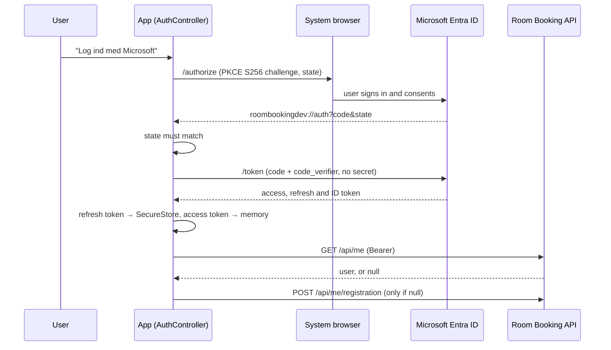

# Room Booking Mobile – Developer Walkthrough

This document explains the mobile client from a developer's perspective: how
it is structured, how sign-in and API calls work, why it is built this way,
and where its limits are. It describes the code as it is, and links to the
source.

The API, database, authorization model and backup tooling are explained in
the backend walkthrough:
[meeting-room-booking/docs/PROJECT_WALKTHROUGH.md](https://github.com/kris7011/meeting-room-booking/blob/main/docs/PROJECT_WALKTHROUGH.md).

**Status labels used throughout**

| Label | Meaning |
| --- | --- |
| **[Tested]** | Implemented and covered by automated tests that run in CI. |
| **[Manual]** | Implemented; verified only by hand on a device, or not verified at all. |
| **[In review]** | Implemented on an open pull request, not yet on `main`. |
| **[Not implemented]** | Proposed or future work. Nothing in the code does this yet. |

Last reviewed: 2026-10-28, after PR #37 (booking privacy) was merged, with
its Samsung check, and issue #34 was closed with its evidence below.

**Related documents:** [local development](local-development.md) ·
[Microsoft Entra sign-in](entra-login.md) · [organisations](organisations.md) ·
[time handling](time-handling.md) · [testing and CI](testing.md) ·
[Android development build](android-development-build.md) ·
[device testing](device-testing.md) · [local/hosted API](api-targets.md) ·
[dependency advisories](security-advisories.md) · [ADRs](adr/README.md)

---

## 1. What the app does

A member of an organisation opens the app, signs in with a Microsoft account,
picks the number of participants, a day and a time, sees the free rooms with
the smallest fitting room first, and books one. Owners and Admins can also
manage rooms, members and invitations. The user interface is in Danish; code
and documentation are in English.

The app has three operating modes:

| Mode | When | Data |
| --- | --- | --- |
| Demo | `EXPO_PUBLIC_API_URL` not set | In-memory fake API (`src/api/demo-api.ts`), clearly labelled |
| Live, signed out | API URL set, nobody signed in (always on web) | Original `/api/rooms` and `/api/bookings` only when the backend's Development-only anonymous demo mode is enabled; otherwise the API requires sign-in |
| Live, signed in | Android/iOS development build, signed in and registered | `/api/organizations/{id}/…` of the active organisation |

## 2. Structure

```text
App.tsx                    Providers only: SafeArea → AuthProvider → SessionProvider → AppScreens
src/
  config/                  env.ts (EXPO_PUBLIC_API_URL), build.ts (__DEV__)
  auth/                    Microsoft sign-in: AuthController, token client, ID token, SecureStore session
  api/                     http-client.ts (fetch, tokens, errors), live/demo/organisation API clients
  organizations/           OrganizationController, SessionProvider, permissions, invitation links
  bookings/                booking-submission.ts: Idempotency-Key per booking, safe retry after a lost answer;
                           booking-area-choice.ts: which booking area (and API) the home screen shows
  screens/                 AppScreens (booking ↔ administration), HomeScreen, OrganizationAdminScreen
  components/              Presentational components; admin/ and organizations/ sub-folders
  models/                  TypeScript types mirroring the API contracts
  hooks/, utils/           Clock, date/time, search window, room fit
tests/                     Node test runner (node:test), mirrors src/
e2e/                       Playwright tests of the web build against the real .NET API
scripts/Set-ApiTarget.ps1  Switch the development build between local and hosted API [Manual]
```

Navigation is plain React state (`AppScreens` switches between two screens),
not Expo Router: the app has two pages and no deep navigation hierarchy.

**Logic without React.** The parts that carry the risk (`AuthController`,
`OrganizationController`, `http-client.ts`, `session-storage.ts`) import
neither React nor Expo. Their dependencies (storage, token endpoint, API) are
passed in, so the Node test runner exercises them with fakes. React
components are thin wrappers (`AuthProvider`, `SessionProvider`).

## 3. Technologies

| Technology | Responsibility |
| --- | --- |
| Expo SDK 58, React Native, React, TypeScript (strict) | The app, Android/iOS/web from one code base |
| expo-auth-session, expo-web-browser, expo-crypto | Authorization code flow with PKCE in the system browser |
| expo-secure-store | Refresh token storage (Android Keystore / iOS Keychain) |
| expo-dev-client | The Android development build used on the physical device |
| react-native-web | The browser build, used by the E2E tests |
| `node:test` | Unit and integration tests of the logic (`npm test`) |
| ESLint 9 + `eslint-config-expo` 58 | Static checks (`npm run lint`, flat config in `eslint.config.js`) |
| Playwright | End-to-end tests of the web build against the real API |
| GitHub Actions | Typecheck, lint, tests, Expo Doctor, E2E |

## 4. Sign-in

Code: [`auth-controller.ts`](../src/auth/auth-controller.ts),
[`auth-runtime.native.ts`](../src/auth/auth-runtime.native.ts),
[`token-client.ts`](../src/auth/token-client.ts),
[`id-token.ts`](../src/auth/id-token.ts),
[`session-storage.ts`](../src/auth/session-storage.ts),
[`secure-store.native.ts`](../src/auth/secure-store.native.ts).



- **Public client with PKCE.** A mobile app cannot keep a secret, so there is
  none. PKCE binds the authorization code to this app instance: an
  intercepted code is useless without the code verifier. **[Tested]** with a
  fake token endpoint. **[Manual]** against real Entra: a personal-account
  sign-in completed in the Android development build on 26 October 2026; work
  or school accounts not tried (see
  [section 7](#still-requires-the-physical-android-device)).
- **Where tokens live.** Only the refresh token is persisted, in SecureStore
  (`WHEN_UNLOCKED_THIS_DEVICE_ONLY` on iOS), split into chunks of at most
  1,800 characters because some platforms reject large values. The access
  token stays in memory. **[Tested]** with an in-memory store.
- **The ID token is for display only.** `id-token.ts` checks audience,
  issuer, expiry and `oid`, but not the signature (OpenID Connect allows this
  when the token comes directly from the token endpoint over TLS). Nothing in
  the app grants access based on it; the API decides who the user is.
- **Renewal.** `getAccessGrant()` returns the access token if it is valid for
  at least 2 more minutes (`ACCESS_TOKEN_RENEWAL_MARGIN_MS`), otherwise it
  refreshes. Parallel requests share one refresh (`refreshInFlight`).
- **No request changes identity.** Every sign-in and sign-out increments a
  `generation` counter. A grant remembers its generation (`isCurrent()`), and
  `http-client.ts` checks it right before `fetch`. A request that started as
  user A is never sent as user B or anonymously after a sign-out. **[Tested]**
- **One session at a time.** `signIn()` does nothing while a login is open
  or someone is signed in; switching accounts means `signOut()` first. The
  account panel only offers sign-in when signed out, but the controller does
  not rely on that: a cancelled second login could otherwise show "signed
  out" while the first session still had tokens. **[Tested]**
- **Availability.** Sign-in is off on web and in Expo Go, because the
  redirect `roombookingdev://auth` only reaches the development build
  (`auth-availability.ts`).

## 5. Calling the API

Code: [`http-client.ts`](../src/api/http-client.ts).

- `requestJson` builds the URL from `EXPO_PUBLIC_API_URL`, attaches the token
  when allowed, applies a 10-second timeout and turns every failure into one
  `ApiError` type (`network`, `timeout`, `http`, `invalid-response`,
  `not-configured`, `auth`), so screens need a single error branch.
- On `401` it renews the token once and retries once, still bound to the
  original session.
- Problem Details from the API are parsed, and `error-messages.ts` maps them
  to Danish messages using the API's stable `code` values. That includes the
  codes for lost access (`organization_not_found`,
  `organization_permission_denied`, `user_disabled`, `user_not_registered`)
  and for bookings, because a member can be removed, demoted or disabled on
  another device while searching or booking. The API's English `detail` is
  only shown for codes the app does not know. Codes that only the
  administration screens meet are in `organizations/organization-messages.ts`,
  which falls back to `error-messages.ts`.
- **Platform-specific and single messages [Tested]**: a `network`
  error mentions CORS only in the web build, because only a browser blocks
  a response by CORS. `describeError` reads `process.env.EXPO_OS`, which Metro
  inlines with the platform it bundles for, so the Android bundle does not
  even contain the web text (checked in exported bundles; the web E2E test
  checks the hint). In the account panel, `sessionWarningToShow`
  (`current-user.ts`) hides the session warning when the identity line already
  shows the same text: after an offline start, the token renewal and the
  `/api/me` check fail with one error, and the identity line keeps it with
  *Prøv igen*.

### Safe booking retries [Tested]

Code: [`booking-submission.ts`](../src/bookings/booking-submission.ts),
[`BookingArea.tsx`](../src/components/BookingArea.tsx); rationale in
[ADR 0003](adr/0003-safe-booking-retries.md); the API side is backend ADR 0005.

- Every booking operation carries a random v4 UUID as `Idempotency-Key`
  (`attemptFor`). Exactly the same request again keeps the key; a changed
  room, time, title or name is a new operation with a new key.
- `isOutcomeUncertain`: after a timeout, a dropped connection, a `5xx` or an
  unreadable success the booking **may** exist. The app then shows "Vi ved
  ikke, om bookingen blev oprettet" with **Prøv igen**, keeps the draft and the
  key, and reloads the upcoming bookings. It never says the booking failed.
- **Prøv igen** sends the stored request unchanged. The API answers with the
  booking it already saved (`200`) or creates it (`201`); either way the app
  shows "Booking oprettet" and there is one booking.
- `BookingArea` keeps the submission, so closing the form or searching again
  keeps the key (the warning then shows above the results). A `4xx` refusal or
  a booking ends the operation and drops the key.
- New Danish messages: `created_booking_deleted` (`410`) and
  `idempotency_key_reused` (`422`).

### Where a token may be sent [Tested]

`canSendBearerToken(url, { development })` is the security boundary for
transport:

| Bundle | Token sent to |
| --- | --- |
| Release | `https://` only |
| Development (`__DEV__`) | `https://`, plus `http://` to `localhost`, `127.0.0.0/8`, `::1` and `10.0.2.2` (Android emulator) |

Anything else, including `http://192.168.x.x` on Wi-Fi, gets **no token**: the
request is sent anonymously and the token is not even renewed for it. The rule
is in the app, so it holds whatever `.env.local` contains. On a physical
phone, `adb reverse tcp:5003 tcp:5003` makes the phone's `localhost:5003` the
PC's `localhost:5003` over USB, so the token never crosses a network.

### Choosing the API [Tested]

The whole decision is made in [`src/config/env.ts`](../src/config/env.ts), from
one value:

1. Metro reads `.env.local` when it starts and **inlines**
   `process.env.EXPO_PUBLIC_API_URL` into the JavaScript bundle as a string
   literal. Only that static dot notation is replaced, which is why `env.ts`
   reads it exactly that way and nowhere else.
2. `env.ts` trims it and strips trailing slashes → `apiBaseUrl`. Empty or
   unset → `apiBaseUrl = null` → `isDemoMode = true`, and the app uses the
   in-memory demo API (`ApiModeBanner` labels it).
3. `buildUrl` in `http-client.ts` prefixes every path with `apiBaseUrl`.
   `canSendBearerToken` (above) then decides per request whether the token may
   go along: HTTPS always, plain HTTP only to loopback in a development bundle.

`scripts/Set-ApiTarget.ps1` changes only the `EXPO_PUBLIC_API_URL` line in
`.env.local` and leaves the Entra settings alone: `-Mode Local` →
`http://localhost:5003`, `-Mode Hosted -HostedUrl https://…` (HTTP,
credentials, query strings and fragments are rejected; duplicates of the key
are refused without writing). Because the value is inlined, **Metro must be
restarted with `--clear`** afterwards, and an installed release build can never
switch servers; see [ADR 0002](adr/0002-api-target-and-token-transport.md).

The two layers are deliberately separate: the script is a convenience that can
be bypassed by editing `.env.local` by hand; `canSendBearerToken` is the
security rule and holds whatever the file says.

## 6. Organisations and authorization in the app

Code: [`organization-controller.ts`](../src/organizations/organization-controller.ts),
[`SessionProvider.tsx`](../src/organizations/SessionProvider.tsx),
[`permissions.ts`](../src/organizations/permissions.ts),
[`HomeScreen.tsx`](../src/screens/HomeScreen.tsx).

- `OrganizationController` loads the user's organisations, restores the last
  choice per user from SecureStore, and drops responses that arrive after a
  newer one, after the user signed out, or after the user created or left an
  organisation. **[Tested]**
- **Access synchronisation [Tested]** ([ADR 0004](adr/0004-organization-access-sync.md)).
  `sync(reason)` reloads the list when the app returns to the foreground
  (skipped while the list is younger than 30 s), when the user switches
  organisation, when any API answer says the access changed
  (`organization_not_found`, `organization_permission_denied`, `user_disabled`,
  `user_not_registered`; reported by `setAccessChangedListener` in
  `http-client.ts`), and on "Prøv igen". A sync joins one already running; no
  timer polls. A lost active organisation falls back to another (or to
  onboarding) with a Danish notice; a changed role is applied with a notice,
  and the administration page and the upcoming bookings load again for it
  (keyed by role) while the search and draft stay. A disabled or unregistered
  account clears the list, and **[Tested]** also makes
  `useServerIdentity` ask `/api/me` again (`shouldRecheckIdentity` in
  `current-user.ts`, codes in `ACCOUNT_REFUSED_CODES`), so the account panel
  shows the API's refusal instead of a stale *✓ Registreret*. Only a
  registered identity is checked again: `/api/me` answers a disabled account
  with the same `403 user_disabled`, and that answer must not start another
  check. Offline or a server error keeps the list but says it
  may be out of date ("Serveren afgør stadig, hvad du må"). The local role is
  never an authority: the API checks every request. The `AppState` and
  listener wiring in `SessionProvider` is not covered by an automated test.
- `HomeScreen` renders `BookingArea` with `key={active.publicId}`. Changing
  the key makes React discard the component and its state, so switching
  organisations always starts with an empty search, form and list.
- **Which booking area [Tested]**: `chooseBookingArea` in
  [`booking-area-choice.ts`](../src/bookings/booking-area-choice.ts) decides
  it, and `HomeScreen` only renders the choice. A booking area loads the room
  overview as soon as it is mounted, so the rule also decides the first
  request. Demo mode: demo data. While a stored session is being restored:
  none, so no token-less `GET /api/rooms` (answered `401`) leaves the app at
  a cold start. Signed out or without sign-in: the original endpoints. A
  registered user: the active organisation. An API without organisations
  (`unsupported`, `not-configured`, `registration-unsupported`) or one the
  token is not sent to (`insecure-transport`): the original endpoints.
  Otherwise (still checking, or `/api/me` refused the user or failed):
  none; the account panel says why and offers *Prøv igen*. The original
  endpoints serve only the legacy organisation, so they would repeat the
  refusal or put the user there without their choosing it.
- Every request names its organisation in the URL, so a late response can
  only ever describe the organisation it was asked for.
- What the UI shows or hides (`canAdminister`, `canModify` from the API) is a
  **convenience only**. The API enforces every rule itself.
- **Private booking details [Tested]**: the API sends a Member other
  people's bookings without title and booked-by (`detailsHidden`, backend
  ADR 0006), so the data never reaches the phone. `bookingListText`
  ([`booking-display.ts`](../src/bookings/booking-display.ts)) shows them in
  *Kommende bookinger* as *Optaget* with room and time.
- **The only Owner** (`memberActions`, `isSoleOwner` in `permissions.ts`): in a
  loaded member list, the Owner who is the only one is offered neither role
  chips for themselves nor *Forlad organisationen*, but a Danish explanation
  (`describeSoleOwner`) of how to make someone else Owner first. With several
  Owners both stay available. Nothing is offered while the list is loading or
  failed. `MembersSection` drops a list response for an organisation the user
  has switched away from, and reloads the list after a refused change, since
  the list may be out of date (another device); the API's `409 last_owner`
  stays the final word. **[Tested]** rules (`organization-rules.test.ts`);
  the screen itself is not covered by an automated test.
- Invitation links: `roombookingdev://invitation?token=…` pre-fills the
  accept form (`invitation-link.ts`). **[Tested]** parsing; not yet opened on a device.

## 7. Testing strategy

| Layer | What | Status |
| --- | --- | --- |
| Unit/integration (`npm test`) | Auth controller, token client, ID token, session storage, HTTP client (auth, transport, errors, access-changed signal), API clients against a mocked `fetch` that copies the backend contract, organisation controller (incl. access synchronisation) and rules, booking submission and retries, date/time and search logic, plus Git ignore-behaviour tests | 463 tests passed on 2026-10-28 in CI and locally on PR #37 (booking privacy, `bookingListText`, +5). Before it: 458 tests passed on 2026-10-28 in CI and locally on PR #32's final head `e380cd4` (its tree is `main` after the Phase 5F merges); 447 after #30 and 452 after #31 on the way there, 439 on `main` before them ([merge record](release-readiness.md#6-phase-5f-merge-and-verification)). Earlier that day, 458 on a local merge of the three fix branches (447, 444 and 445 with each alone). Before that: 439 tests passed on 2026-10-27 with Phase 5D PRs B and C combined, locally on PR #27 after merging `main` with PR #26 (407 with B alone, 397 with C alone; 365 on `main` `7db55b7` before them) |
| Type checking (`npm run typecheck`) | App, tests and E2E code under strict TypeScript | Passed on 2026-10-28 in CI and locally on each Phase 5F PR before its merge, last on `e380cd4` (PR #32) |
| Lint (`npm run lint`) | ESLint with Expo's SDK 58 config over app, tests and E2E code; `--max-warnings 0`, so a warning fails CI | Passed on 2026-10-28 in CI and locally on each Phase 5F PR before its merge, last on `e380cd4` (PR #32); in Phase 5B (2026-10-26) a deliberate unused variable made it exit 1 |
| E2E (`npm run test:e2e`) | Web build in Chromium against the real .NET API on a temporary SQLite database: rooms, search, booking, overlap (409), API errors, time handling, sign-in-required message, a booking answer dropped after the API saved it and the safe retry (`booking-retry.spec.ts`) | 38 tests passed on 2026-10-28 on PR #37, on its first attempt against backend `main` before (`91349f0`) and after (`96c92e1`) the booking-privacy change. Before it: 38 tests passed on 2026-10-28 on the issue #34 fix (PR #36, code at `1c99a25`), locally and in CI on the first attempt, against backend `main` `91349f0`; the new test chooses a day before the day strip has reported its layout. Before it: 37 tests passed on 2026-10-28 in CI and locally on each Phase 5F PR before its merge, last on `e380cd4` (PR #32), against backend `main` `91349f0`. Earlier: 37 on 2026-10-27 locally on PR #27 after merging `main`, against backend `main` `91349f0` (PR #18 merged; `E2E_BACKEND_DIR`, temporary SQLite file); 34 before PR #26 added `booking-retry.spec.ts` |
| Expo Doctor | Dependency versions match the SDK version list Expo publishes | 20/20 on 2026-10-28 after PR #29 was merged, in CI and locally on every later Phase 5F PR. Earlier that day 19/20, on `main` too: Expo had published new SDK 58 patch versions of `expo`, `expo-auth-session`, `expo-dev-client` and `expo-web-browser`, which PR #29 aligned. Before that, 20/20 on 2026-10-27 (PR #27 after merging `main`; one earlier local run that day failed three checks, including an icon-package conflict with no icon package installed, and the next three runs passed unchanged); first 20/20 on 2026-10-24 after `e104927` (merged PR #11) |
| API target script | `Set-ApiTarget.ps1`: hosted/local switch, Entra lines preserved, unsafe URLs and duplicate keys rejected | [Tested] in CI on Linux `pwsh`; [Manual] on Windows PowerShell 5.1, 2026-10-24 (isolated copy, 13 checks) |
| Device (Samsung SM-A057G) | Development build, redirect, `adb reverse`; the [sign-in checklist](device-testing.md#sign-in-checklist) | [Manual], partly done. Development build, redirect and deep link (PR #6), `adb reverse` (PR #7). The 23 October personal-account rejection is diagnosed in issue #16 ([details](device-testing.md#personal-account-rejection-23-october-2026)). On 26 October, in the rebuilt development build: `/common/` authority and redirect handler configured, registration shown and personal-account session restored after restarts (logged); sign-out and a new interactive sign-in, and a signed-in booking kept after a restart (owner reports); Owner administration with writes on an isolated database copy (logged, [checklist](device-testing.md#organisation-administration-checklist-26-october-2026)). On 27 October, on an isolated database copy (logged): the sole-Owner member list of PR #22 (S1, S3, S5, S6), booking retries and organisation access refresh (D1–D8), an offline start, and a cold start after more than a day without a browser login ([Phase 5E run](device-testing.md#phase-5e-run-27-october-2026)). On 28 October, on the build rebuilt from `main` `ccc8204` (SDK 58 patches of PR #29) and an isolated database copy (logged): the Phase 5F checks F1–F4, sign-out and a new sign-in (account picker by owner report), SecureStore contents and logs free of tokens ([Phase 5F run](device-testing.md#phase-5f-run-28-october-2026)). Later on 28 October, the same build with JavaScript from PR #36 (`1c99a25`): a day-strip smoke test, read-only on an isolated database copy (logged, [details](device-testing.md#day-strip-smoke-test-pr-36-28-october-2026)). Not run: work or school account, a new user's first sign-in, Admin/Member views, TalkBack (S4), cancelled sign-in, invitation links, time handling; the owner's procedure for the ones a single account allows is in [device-testing.md](device-testing.md#phase-5c-manual-checks-for-the-owner). See [device-testing.md](device-testing.md#current-status). |

**Not covered by automated tests:** React Native components on Android/iOS
(there are no component tests; components are exercised only through the web
build in E2E), the real Microsoft sign-in, SecureStore on a device, and
signed-in organisation flows end to end (E2E runs the web build without
sign-in).

### Still requires the physical Android device

These cannot be verified on Windows, by CI or in the web build. Done on
26 October 2026 (see [device-testing.md](device-testing.md#current-status)):
the rebuilt development build; personal-account sign-in and the redirect
back to `roombookingdev://auth`; the session restored across restarts and a
new sign-in after sign-out; signed-in requests to the local API over
`adb reverse`; organisation switching and the Owner's screens. On 27 October:
an offline start and a silent renewal (indirectly). On 28 October, on the
development build rebuilt from `main`: the Phase 5F checks F1–F4, a logged
sign-out and new sign-in, and SecureStore contents before and after sign-out
([details](device-testing.md#sign-in-on-the-rebuilt-build-28-october)). Still open:

1. A work or school account, and the first sign-in (registration) of a new
   account.
2. Revoked sessions and a cancelled sign-in.
3. A **restored** database behind `Set-ApiTarget.ps1 -Mode Local`: the
   organisations, rooms, bookings and roles look as they did before.
4. Token transport on the device: a plain-HTTP Wi-Fi address gets no token.
5. Invitation deep link `roombookingdev://invitation?token=…`.
6. Admin and Member screens and accepting an invitation, which need a second
   account (the API side is covered by its integration tests).

## 8. Local development

- `npm ci`, then `npm run web` (browser, demo or live) or
  `npx expo start --dev-client` (Android development build).
- `.env.local` holds `EXPO_PUBLIC_API_URL` and the Entra identifiers. They are
  identifiers, not secrets, and are visible in the bundle.
- For the local API on a physical phone: start the API with the backend's
  `scripts/Start-Local.ps1`, then `Set-ApiTarget.ps1 -Mode Local` and
  `adb reverse tcp:5003 tcp:5003` (and `tcp:8081` for Metro). See
  [api-targets.md](api-targets.md).

## 9. Builds and deployment

- **Development build:** `npx expo run:android` produces
  `io.github.kris7011.roombooking.dev`. **[Manual]**, built and installed on a
  Samsung SM-A057G (PR #6), and rebuilt after `e104927` on 26 October 2026.
  The SDK 58 patch update merged on 28 October (PR #29) changes native
  modules, so the build was made again from `main` `ccc8204` the same day and
  installed as an update, keeping the app's data
  ([record](device-testing.md#rebuild-28-october-2026);
  [procedure](device-testing.md#rebuilding-the-development-build)). The next
  patch update (29 October: `expo` 58.0.21, `react-native` 0.88.1 and others,
  PR #40) changes native code again; the build on the phone predates it.
- **Release/production builds: [Not implemented].** There is no `eas.json`,
  no release package ID, no release redirect URI registration, and no store
  configuration. A release build would send tokens over HTTPS only, so it
  cannot use a local HTTP API.
- **Release readiness:** what a first Android release still needs (build
  profiles, signing, the HTTPS API, the Entra release redirect URI, open
  device checks) is tracked in [release-readiness.md](release-readiness.md).
  Assessment on 28 October 2026: not release-ready.

## 10. Design decisions

| Decision | Why | Cost | Record |
| --- | --- | --- | --- |
| Native sign-in as a public client with PKCE; refresh token in SecureStore, access token in memory | Standard for native apps (RFC 8252); no secret to leak | Device-only flow, needs a development build | [ADR 0001](adr/0001-native-sign-in-and-token-storage.md) |
| Token transport rule in the app; API chosen at bundle time | Security does not depend on configuration discipline | Switching servers needs a Metro restart or a new build | [ADR 0002](adr/0002-api-target-and-token-transport.md) |
| Logic in framework-free modules with injected dependencies | Fast, deterministic tests without a device | More wiring code | – |
| React `key` per organisation | Impossible to show the previous organisation's state | Re-mounts the booking area on every switch | – |
| Idempotency-Key per booking operation, kept by `BookingArea` until the outcome is certain | A lost answer can be retried without a duplicate or a false "failed" | Key in memory only | [ADR 0003](adr/0003-safe-booking-retries.md) |
| Organisation access synchronised at lifecycle moments, no polling | Stale roles corrected when the user looks or acts, with little battery or data | An idle foreground app does not notice a change until the next request | [ADR 0004](adr/0004-organization-access-sync.md) |
| Plain state instead of Expo Router | Two screens do not need a router | Would need migration if navigation grows | – |

## 11. Known limitations

- **No release build pipeline** and no in-app server selection.
- **Expo Doctor depends on Expo's live version list.** It compares the
  lockfile with the SDK 58 versions Expo publishes at run time, so a new Expo
  patch release can fail CI without any change here (it did on 2026-10-24;
  fixed by `e104927`, which bumped only the two reported packages, and on
  `main` by the now-merged PR #11). This is
  intended: it is the signal to update. A version bump that changes native
  modules also means rebuilding the installed development build (last done
  on 2026-10-28, after PR #29).
- **No component tests.** The logic behind components is tested in `npm test`;
  rendering is checked by the web E2E tests only.
- **Intermittent E2E failure (issue #34): fixed and closed.**
  `e2e/specs/search.spec.ts:35` (a day chip scrolled into view) failed twice
  in CI on 28 October 2026. Cause, reproduced deterministically: React Native
  Web reads a node's `onLayout` handler in its `ResizeObserver` callback but
  calls it in a later task (`setTimeout(0)`); a tap in between leaves
  `DaySelector` running layout handlers from the render before the tap, which
  still see the previous selection. `DaySelector` now reads the selection
  from a ref (PR #36). Closure evidence: the committed regression test that
  forces this ordering failed 5/5 without the fix and passed 20/20 with it;
  `search.spec.ts:35` then passed **100/100** repetitions locally with the CI
  browser and `retries: 0`; and every CI E2E run after the fix (6 runs on pull
  requests and `main`, 28 October) passed on its first attempt. That the two
  CI failures took exactly this path is inferred from their traces, not
  observed; `retries` stay at 0, so any recurrence is visible and reopens the
  issue. On Android the day strip behaved correctly with the fix
  ([smoke test](device-testing.md#day-strip-smoke-test-pr-36-28-october-2026));
  the race itself was shown on the web build only.
- **Lint baseline.** `react-hooks/set-state-in-effect` is switched off for the
  ten existing files (components and one hook) that set state synchronously in an effect
  (listed in `eslint.config.js`); all other and all new files are checked.
  Refactoring those components is a follow-up.
- **CI checks are not "required" on GitHub.** `main` has no branch protection
  or ruleset, so a failing check shows red but does not technically prevent a
  merge. The repository is public, so both are available on GitHub Free;
  turning them on is the owner's decision.
- **`npm audit` reports high-severity findings** in the Expo CLI tooling
  (`@expo/cli`, `@expo/config`), not in the app bundle;
  `npm audit fix --force` would downgrade the SDK. The current findings and
  their dependency paths are in [security-advisories.md](security-advisories.md).
- **No sign-in in this app's web build**, by decision: it uses the API's
  anonymous demo mode. The Angular client in the backend repository has its
  own Microsoft sign-in (backend ADR 0007).
- **E-mail one-time-code sign-in (Entra External ID) is not implemented.** It
  was in the architecture plan of 21 October 2026 but needs an External ID
  tenant. Personal Microsoft accounts sign in through Microsoft; the app and
  API store no passwords.
- **iOS has never been built or tested.**
- **Signed-in flows are not tested end to end**; they rely on unit tests with
  fakes and manual device checks.
- **Sign-in needs the internet** (Microsoft Entra), also when the API runs
  locally.
- **No offline mode**: bookings are not cached or queued.
- **A booking's Idempotency-Key lives in memory.** If the app is killed while
  the outcome is uncertain, the next attempt is a new request; for the same
  slot the API then answers `409 booking_overlap`. The web build needs a
  backend whose Development CORS allows `Idempotency-Key` (backend PR #18);
  an older API ignores the header on Android.
- **Access changes made elsewhere are noticed at lifecycle moments only**
  (foreground after 30 s, switch, a refused request, "Prøv igen"), not while
  the app sits idle in the foreground. Network return is not detected
  directly. Organisation selection keys stay in SecureStore after sign-out
  (they hold no secret; unchanged).

## 12. How this project was built

This project was developed with AI assistance (Claude Code). Some commits
carry a `Co-Authored-By: Claude` trailer, but commit trailers alone do not
measure the full extent of AI involvement.

Every change is verified the same way regardless of who wrote it: type
checking, the automated test suites and CI must pass, and behaviour on a
physical device is checked by hand. The status labels in this document record
which of those checks applies to each part.
